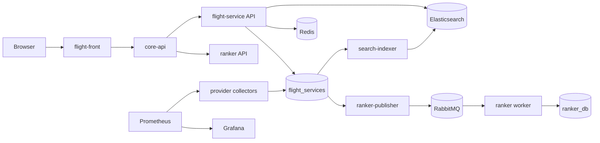
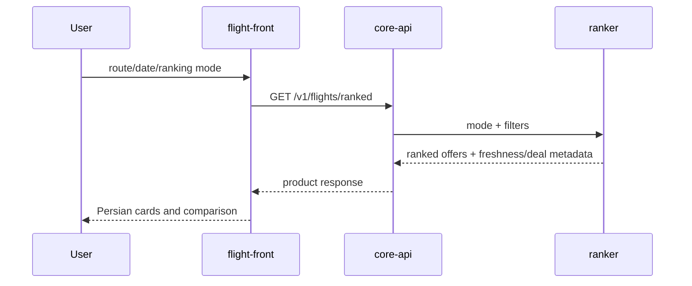
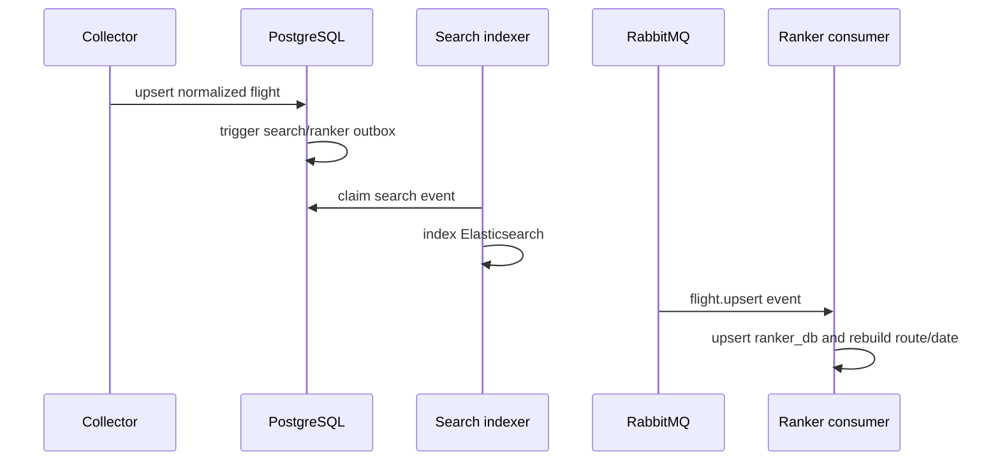

# Torob Flight Intelligence

Torob Flight Intelligence compares Iranian flight offers across multiple
providers. PostgreSQL is authoritative; Elasticsearch and ranker_db are read
models; core-api is the product contract; flight-front is the Persian UI.

## Projects

| Project | Responsibility | Entry |
|---|---|---|
| `infra` | PostgreSQL, Redis, RabbitMQ, Elasticsearch, Prometheus, Grafana, network | `infra/up.sh` |
| `flight-service` | Routes, jobs, collectors, offers, freshness, search/ranker outboxes | internal `:8090` |
| `ranker` | RabbitMQ consumer, independent database, ranking worker/API | `:8081` |
| `core-api` | Product API and service adapters | `:8080` |
| `flight-front` | Persian RTL search, filters, comparison, provider links | `:3000` |

## Runtime topology



Every container joins the infrastructure-owned `torob-net` network.

## Startup

```bash
cd infra && cp .env.example .env && ./up.sh
cd ../flight-service && docker compose up -d --build
cd ../ranker && docker compose up -d --build
cd ../core-api && docker compose up -d --build
cd ../flight-front && docker compose up -d --build
```

## Search request flow



## Collection and event flow



## Event format

RabbitMQ exchange `torob.flights`, queue `torob.ranker`, routing key
`flight.upsert`. The body is the complete flight row:

```json
{"id":123,"origin":"IKA","destination":"MHD","flight_date":"2026-11-23","airline_code":"I3","flight_number":"956","depart_at":"2026-11-23T07:30:00+03:30","arrive_at":"2026-11-23T09:00:00+03:30","duration_min":90,"baggage_kg":20,"price_toman":8500000,"is_charter":false,"stops":0,"source":"alibaba","collected_at":"2026-11-03T23:20:00Z"}
```

The publisher replays current flights at startup, and the ranker accepts both
PostgreSQL date-only and RFC3339 date values.

## Marketplace natural-language search

`GET /v1/marketplace/search?q=پرواز تهران به قشم قشم ایر` is the frontend
marketplace endpoint. The browser calls Core API only; Core API forwards the
query to flight-service, which extracts known Persian city and airline tokens,
then executes its normal Elasticsearch-first search with PostgreSQL fallback.
The response returns the original query, parsed `origin`, `destination`, and
`airline` intent, plus the normal offer search result. This makes the initial
rule-based interpretation visible and replaceable by a future NLP service.

## Database ERD

```mermaid
erDiagram
  AIRPORTS ||--o{ ROUTES : origin
  AIRPORTS ||--o{ ROUTES : destination
  ROUTES ||--o{ JOBS : schedules
  ROUTES ||--o{ COLLECTOR_ROUTE_STATE : provider_state
  JOBS ||--o{ COLLECTION_RUNS : records
  FLIGHTS ||--o{ FLIGHT_SEARCH_OUTBOX : indexes
  FLIGHTS ||--o{ FLIGHT_RANKER_OUTBOX : publishes
  FLIGHTS { bigint id PK; text origin; text destination; date flight_date; text airline_code; timestamptz depart_at; timestamptz arrive_at; bigint price_toman; int stops; int duration_min; text source; timestamptz collected_at }
  AIRPORTS { text code PK; text city_code; text city_name_fa; text country_code }
  ROUTES { bigint id PK; text origin; text destination; int priority; boolean enabled }
  JOBS { bigint id PK; text source; text kind; text status; bigint route_id; date flight_date }
  COLLECTION_RUNS { bigint id PK; bigint job_id; text source; int flights_upserted; boolean ok }
  FLIGHT_SEARCH_OUTBOX { bigint id PK; bigint flight_id; text operation; int attempts }
  FLIGHT_RANKER_OUTBOX { bigint id PK; bigint flight_id; jsonb payload; int attempts }
```

The ranker database mirrors flight fields in `flights` and stores ordered
`ranked_flights(flight_id, origin, destination, flight_date, rank, score)`.

## Freshness, ranking, and operations

Freshness windows are 5 minutes for today/tomorrow, 15 minutes within seven
days, and 60 minutes later. Ranking modes are `best-value`, `cheapest`,
`fastest`, and `baggage`. Results expose freshness age, verification status,
route median price, deal label, recommendation reason, and provider URL.

All Go services use structured `slog` records. Important fields include
`request_id`, `service`, `source`, `route`, `flight_id`, `job_id`, `attempt`,
`duration_ms`, and `error`. Prometheus is on `:9090`; Grafana is on `:3001`.

Detailed service documents:

- [flight-service/docs/ARCHITECTURE.md](flight-service/docs/ARCHITECTURE.md)
- [ranker/docs/ARCHITECTURE.md](ranker/docs/ARCHITECTURE.md)
- [core-api/docs/ARCHITECTURE.md](core-api/docs/ARCHITECTURE.md)
- [flight-front/docs/ARCHITECTURE.md](flight-front/docs/ARCHITECTURE.md)
- [infra/docs/ARCHITECTURE.md](infra/docs/ARCHITECTURE.md)
