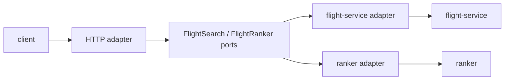

# Core API

Core API owns request validation, request IDs, stable product contracts, and
dependency translation. It never queries Elasticsearch or PostgreSQL directly.

Endpoints: `GET /v1/flights`, `GET /v1/search/flights`,
`GET /v1/marketplace/search?q=...`, `GET /v1/flights/ranked`,
`GET /health/live`, and `GET /health/ready`.

Every request logs method, path, status, response bytes, latency, and request
ID. Downstream failures are returned with stable error codes.
