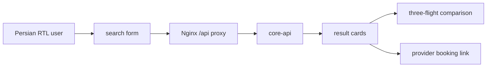

# Flight-front

The frontend owns Persian formatting, ranking-mode selection, stop/airline
filters, loading/error states, comparison, freshness/deal explanations, and
provider links. It does not call Elasticsearch, PostgreSQL, or ranker directly.
