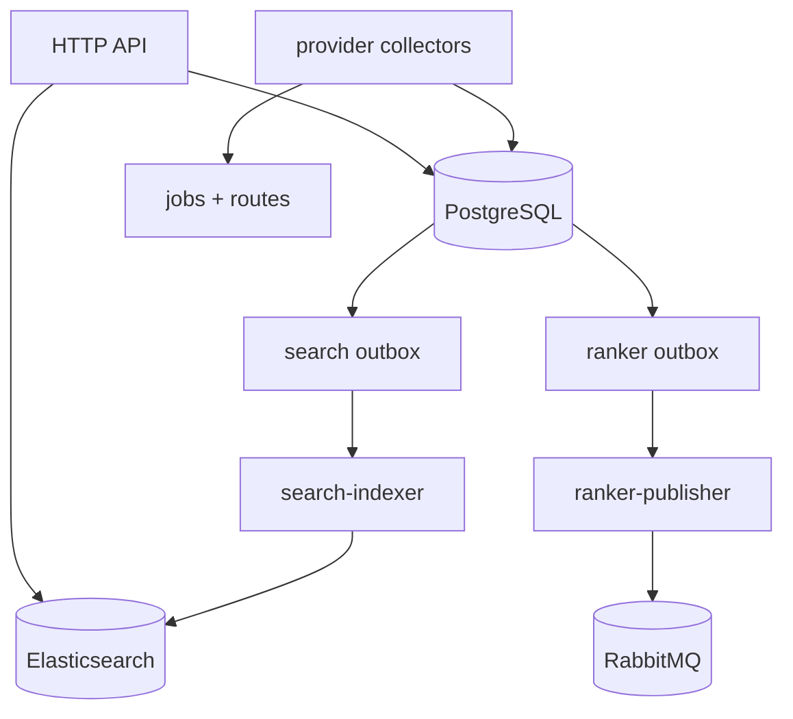

# Flight-service

Collectors normalize provider responses into `shared/domain/flight.Flight`.
Each upsert triggers durable search and ranker outbox rows. Jobs are
provider-scoped, retry with backoff, reclaim stale locks, and record collection
runs. The API filters stale offers and enqueues asynchronous refresh jobs when
no fresh result exists.

## Main tables

`airports`, `routes`, `jobs`, `collector_route_state`, `flights`,
`collection_runs`, `flight_search_outbox`, and `flight_ranker_outbox` are
defined in `migrations/001` through `008`.

## Logging

Collectors log startup, migration, route seeding, job claim/defer/failure,
provider calls, offer counts, upserts, circuit state, and shutdown. Include
`source`, `worker`, `job`, `route`, `date`, `attempt`, `flights`, and `duration`.
