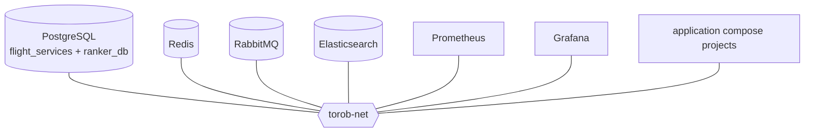

# Infrastructure

Infra owns stateful service images, persistent volumes, health checks, the
shared Docker network, PostgreSQL database bootstrap, and monitoring defaults.
Application Compose projects are stateless and consume infra DNS names.
PostgreSQL init scripts create roles when the volume is new. On every later
start the Postgres and RabbitMQ entrypoints reset application passwords from
the container environment, so existing volumes do not keep stale credentials.
