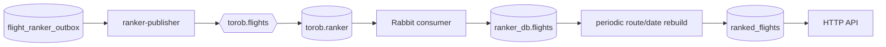

# Ranker

The event body is a complete flight row. The consumer accepts PostgreSQL
`YYYY-MM-DD` dates and RFC3339 timestamps, logs decode/upsert failures, and
acknowledges only successfully mirrored rows. Startup replay allows rebuilding
a new ranker database from the flight-service outbox.

Ranking modes: `cheapest` (price), `fastest` (duration), `baggage` (allowance),
and `best-value` (price/stops/duration/baggage/freshness). The API returns
freshness age, route typical price, deal label, recommendation, and provider
URL.
